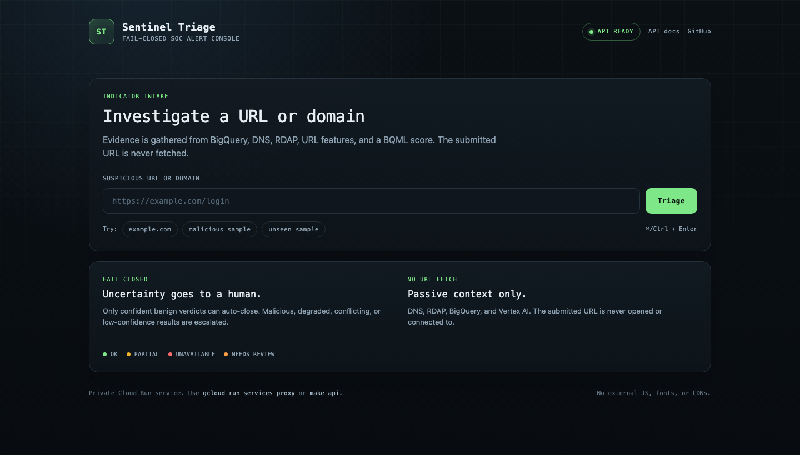
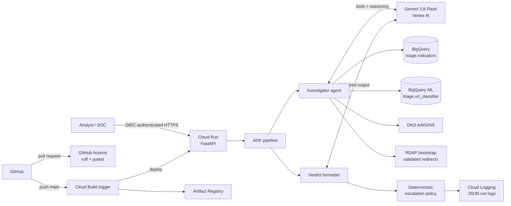

# Sentinel Triage

[](https://github.com/YouFoundTheDev/sentinel-triage/actions/workflows/ci.yml)


**Sentinel Triage is a fail-closed SOC alert triage agent on Google Cloud.** It accepts a
suspicious URL or domain, gathers previous sightings, DNS/RDAP context, lexical URL
features, and a BigQuery ML score, and returns a structured verdict with severity,
confidence, evidence, a recommended action, and an explicit `auto_closed` or
`needs_review` status. The agent never fetches or connects to the submitted URL. A
deterministic policy runs after the model and escalates low-confidence, degraded,
conflicting, or non-benign results instead of silently closing them.

Repository: [`YouFoundTheDev/sentinel-triage`](https://github.com/YouFoundTheDev/sentinel-triage)
(private portfolio build).



## At a glance

| | |
|---|---|
| **Approach** | ADK investigator + tool-free structured verdict formatter, Gemini via Vertex AI |
| **Signals** | BigQuery sightings, DNS A/MX/NS, RDAP age, lexical URL features, BQML probability |
| **Safety** | no URL fetching; deterministic fail-closed policy after every model response |
| **Runtime** | private Cloud Run, authenticated invocations only, scale-to-zero |
| **Delivery** | Cloud Build trigger on `main`; GitHub Actions lint/tests on pull requests |
| **Eval** | 20-case no-ML baseline; honest 12-case ML comparison below |
| **Status** | portfolio/reference project, not production |

## Contents

- [Architecture](#architecture)
- [What this demonstrates](#what-this-demonstrates)
- [GCP services and why](#gcp-services-and-why)
- [Tools and verdict](#tools-and-verdict)
- [Design decisions](#design-decisions)
- [Run locally](#run-locally)
- [Frontend](#frontend)
- [Deploy](#deploy)
- [Evaluation](#evaluation)
- [CI/CD](#cicd)
- [Security](#security)
- [Limitations](#limitations)
- [Roadmap](#what-id-improve-next)
- [Documentation](#documentation)
- [License](#license)

## Architecture



The investigator calls four tools: `lookup_indicator`, `enrich_domain`,
`extract_url_features`, and `ml_score`. A separate tool-free formatter uses
`output_schema=Verdict`; splitting the tool-calling and formatting steps avoids ADK's
unreliable structured-output-plus-tools fallback. The policy then replaces model-provided
evidence with the actual tool calls and enforces escalation in code.

## What this demonstrates

- Agentic tool use with Google ADK, explicit tool schemas, and Gemini structured output.
- Deterministic guardrails after model output rather than prompt-only safety.
- BigQuery + BigQuery ML with parameterized lookups, feature engineering, and a model tool.
- A production-shaped GCP deployment: private Cloud Run, dedicated runtime/builder service
  accounts, Artifact Registry, Cloud Build, and authenticated invocation.
- Honest evaluation, including a documented negative result when ML did not help.
- A dependency-free frontend served by FastAPI with copy/download/history affordances.

## GCP services and why

| Service | Why |
|---|---|
| Cloud Run | Private, scale-to-zero HTTPS service; authenticated invocations only |
| Vertex AI Gemini | Model reasoning and structured verdicts |
| BigQuery | Indicator lookup and the ML feature table |
| BigQuery ML | Logistic-regression URL classifier exposed as `ml_score` |
| Cloud Build + Artifact Registry | Test, build, push, and deploy on push to `main` |
| Cloud Logging | Structured `triage_run` JSON logs |
| IAM service accounts | Dedicated runtime identity and a separate least-privilege builder |
| Secret Manager | Only the Cloud Build GitHub OAuth token; no application secrets |
| GitHub Actions | Pull-request lint and tests with no GCP credentials |

## Tools and verdict

- `lookup_indicator(domain_or_url)` — parameterized BigQuery sighting lookup, including
  `www` variants and malicious/benign conflict detection.
- `enrich_domain(domain)` — DNS A/MX/NS plus RDAP registration date, registrar, and
  nameservers. Every call has a timeout; failures return `partial`/`unavailable`.
- `extract_url_features(url)` — local-only length, subdomain, digit, TLD, IP-host,
  punycode, query/path, keyword, and entropy features.
- `ml_score(url)` — BigQuery ML `ML.PREDICT`; predicted label and class probabilities.

`Verdict` fields: `severity`, `confidence`, `reasoning`, `evidence`,
`recommended_action`, `status`, and `classification`. The policy forces
`needs_review` when confidence is below 0.7, any required tool is missing or degraded,
lookup/ML/verdict evidence conflicts, classification is unknown, or the verdict is
malicious/high severity. Only confident benign verdicts can auto-close.

## Design decisions

| Decision | Why |
|---|---|
| Two ADK agents | Tool-calling and `output_schema` are separated; the combined mode looped during testing |
| No URL fetch | Removes SSRF and accidental interaction with attacker infrastructure |
| Policy after the model | The model can suggest; code decides `needs_review` |
| Cloud Run IAM only | No app-level auth to get wrong; the platform enforces identity |
| Legacy dataset READER | Dataset IAM command is allowlisted in this project; scoped read is preserved |
| `/health` + `/ready` | Cloud Run's edge reserves some `z`-suffixed paths such as `/healthz` |
| ML enabled by default | Demonstrates the tool; the eval shows it can hurt and is treated as one signal |

## Run locally

Prerequisites: Python 3.11+ (uv uses 3.13), uv, gcloud, Application Default Credentials,
and a GCP project with billing enabled.

```bash
cp .env.example .env
# set GOOGLE_CLOUD_PROJECT in .env
gcloud auth application-default login

make install
make data          # OpenPhish + Tranco -> triage.indicators
make ml            # build triage.url_features, train/evaluate triage.url_classifier
make api           # http://127.0.0.1:8080
```

Local API checks:

```bash
curl -s http://127.0.0.1:8080/healthz
curl -s http://127.0.0.1:8080/readyz
curl -s -X POST http://127.0.0.1:8080/triage \
  -H 'Content-Type: application/json' \
  -d '{"indicator":"https://example.com/"}'
```

Tests and evaluation:

```bash
make test
make lint
make eval          # live Vertex AI eval; writes docs/eval.md
```

`/healthz` and `/readyz` work locally and in the container. Cloud Run's edge reserves some
paths ending in `z`, so the deployed service also exposes `/health` and `/ready`.

## Frontend

FastAPI serves a small vanilla HTML/CSS/JS console at `/ui/` — no build step, no CDN, no
external fonts. It shows verdict badges, a confidence ring, recommended action, reasoning,
per-tool evidence, latency, local recent history, and raw JSON with copy/download controls.
It only calls the same-origin API; it never fetches the submitted URL.

Locally:

```bash
make api
open http://127.0.0.1:8080/ui/
```

The Cloud Run service is private, so use the authenticated proxy in a browser:

```bash
gcloud run services proxy soc-triage-agent \
  --region=us-central1 --project=wide-factor-387115 --port=8081
open http://127.0.0.1:8081/ui/
```

The proxy injects your identity token for the page, `/ready`, and `/triage` requests.
`docs/demo.md` contains abridged actual requests and outputs.

## Deploy

```bash
make setup         # enable APIs, runtime SA, dataset access, Artifact Registry
./infra/ci_setup.sh
make deploy        # Cloud Build builds the Dockerfile, pushes, deploys
```

The Cloud Build connection and push trigger are already configured for
`YouFoundTheDev/sentinel-triage`; `infra/README.md` has the exact commands and IAM
rationale. The service is private:

```bash
URL=$(gcloud run services describe soc-triage-agent \
  --region=us-central1 --project=wide-factor-387115 \
  --format='value(status.url)')
TOKEN=$(gcloud auth print-identity-token)

curl -s -H "Authorization: Bearer $TOKEN" "$URL/health"
curl -s -X POST "$URL/triage" \
  -H "Authorization: Bearer $TOKEN" \
  -H "Content-Type: application/json" \
  -d '{"indicator":"https://example.com/"}' | jq
```

`./scripts/demo.sh` runs health, readiness, and two triage examples. Abridged real output
is in `docs/demo.md`.

## Evaluation

The full 20-case no-ML baseline (Stage 3) was:

```text
Labeled accuracy: 72.2% (13/18)
Escalation rate:  65.0% (13/20)
Confidently wrong: 0
```

The Stage 6 with/without-ML comparison uses a **12-case subset** because the full ML run
hit Vertex AI 429/timeout quota:

| Metric | Without ML | With ML |
|---|---:|---:|
| Labeled accuracy | 60.0% | 30.0% |
| Escalation rate | 83.3% | 91.7% |
| Confidently wrong | 0 | 0 |

**The ML tool did not improve this subset.** It conflicted with lookup on two seen
malicious cases and marked a benign login URL as malicious; the formatter and policy
escalated those to `unknown/needs_review`. The BQML holdout metrics are 99.8% accuracy and
1.000 ROC AUC, but they do **not** translate to agent decisions. The lexical features
likely separate feed sources rather than generalize to real-world URL intent. The full
per-case data and limitations are in [`docs/eval.md`](docs/eval.md).

Do not read the BQML holdout metric as production accuracy. The dataset is small and the
Stage 6 ML comparison is quota-limited.

## CI/CD

- `.github/workflows/ci.yml` runs Ruff formatting/checking and pytest on pull requests to `main`.
- `cloudbuild.yaml` runs formatting, lint, tests, builds, pushes, and deploys on pushes to `main`.
- The trigger only deploys if tests pass because steps are sequential.
- Builder account: `soc-triage-builder@wide-factor-387115.iam.gserviceaccount.com` with
  `roles/cloudbuild.builds.builder`, `roles/run.admin`, and `roles/iam.serviceAccountUser`
  only on the runtime SA.

## Security

- Cloud Run is private; unauthenticated requests get 403.
- Runtime SA: dataset `READER` ACL, `roles/bigquery.jobUser`, `roles/aiplatform.user`.
  Dataset-level IAM binding was allowlisted, so the equivalent legacy READER ACL is used;
  `jobUser` is required to execute queries.
- No application secrets in the repo or image. Local runs use ADC; Cloud Run uses the
  runtime service account.
- Container runs as non-root UID 10001.
- The agent never fetches the submitted URL. It only performs DNS queries, validated RDAP
  lookups, BigQuery calls, and Vertex AI calls.
- Lookup and enrichment reject private/internal hosts, URL userinfo, bad schemes, or
  malformed ports; feature extraction only analyzes syntax and also never fetches.

## Limitations

- OpenPhish supplies only ~300 malicious URLs per snapshot; Tranco is a popularity list,
  not a verified benign corpus. `first_seen` is NULL for OpenPhish, and URLhaus now needs
  an Auth-Key.
- The eval is small and single-run; Gemini/ML are nondeterministic. The ML comparison is a
  12-case subset due to Vertex AI quota, and the full 20-case with-ML run is still pending.
- ML features are lexical and correlated with the feed sources, not URL content. The high
  BQML holdout numbers are not trustworthy as production performance.
- RDAP returned HTTP 403 from Cloud Run egress during demos, so benign results often land in
  `needs_review` because enrichment is partial. This is intentional fail-closed behavior.
- Cloud Run cold starts are slow for this ADK image (about 40–75 seconds in demos). The
  service uses min instances 0 to control cost.
- Cloud Run reserves `/healthz` on `run.app`; use `/health` and `/ready`.
- The policy is conservative: only confident benign verdicts auto-close, and every
  malicious/high/critical verdict is escalated.
- There is no SOC/SOAR integration, queueing, rate limiting, per-tenant authorization,
  human-feedback loop, or end-to-end tracing.
- The runtime SA has project-level `jobUser` and `aiplatform.user`; Vertex AI has no
  practical per-model scoping here.

## Documentation

- [Evaluation report](docs/eval.md) — metrics, per-case data, quota limitation.
- [Demo](docs/demo.md) — real requests and abridged outputs.
- [Infrastructure](infra/README.md) — resources, IAM, trigger, deploy commands.
- [Security policy](SECURITY.md) — reporting and security design.
- [Contributing](CONTRIBUTING.md) — local checks and review expectations.

## What I'd improve next

- Use larger, temporally split, less source-correlated URL data; add passive DNS,
  certificate-transparency, and registrar/WHOIS signals without fetching the URL.
- Run the full 20+ case eval repeatedly with confidence calibration and human labels;
  include adversarial prompt-injection cases.
- Evaluate ML alone and in the agent, with feature importance/explainability and a
  boosted-tree baseline; fix the ML/agent conflict behavior with calibrated thresholds.
- Add a human-in-the-loop review queue and store verdicts/labels for active learning.
- Integrate with SOAR/ticketing, add async jobs, idempotency keys, rate limits, and audit
  trails.
- Add SLOs, alerts, tracing, and cost dashboards; consider min instances for latency.
- Harden further with VPC Service Controls, CMEK, Binary Authorization, and a load
  balancer/hosting rewrite if the exact external `/healthz` path is required.

## Cost notes

BigQuery storage and queries are tiny, Cloud Run scales to zero, and BQML training is a
few thousand rows. Vertex AI token usage and Cloud Build/Artifact Registry are the main
costs; the project is not guaranteed to stay within a free tier. Billing was enabled for
this project during the build.

## Repository layout

```text
agent/       ADK investigator/formatter, policy, JSON logging
api/         FastAPI service and vanilla /ui console
data/        download, clean, BigQuery load, feature build, BQML training
tools/       lookup, DNS/RDAP enrichment, URL features, ML score
evals/       labeled cases, raw results (ignored), eval runner
docs/        eval report, demo, console screenshot
infra/       setup, deploy, CI setup, trigger, BigQuery schemas/SQL
tests/       103 unit tests
```

## License

MIT — see [LICENSE](LICENSE).
